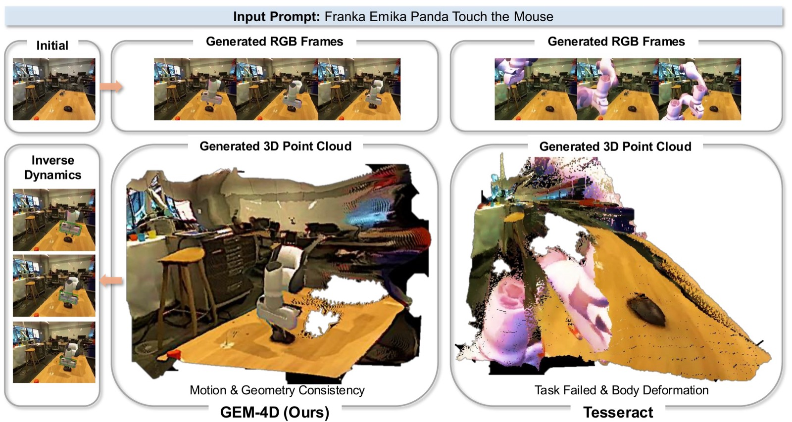

<div align="center">

  <h1>GEM-4D: Geometry-Enhanced Video World Models<br/>for Robot Manipulation</h1>

  <p>
    <b>Kaichen Zhou</b><sup>1,2,*</sup> &nbsp;
    <b>Yuzhen Chen</b><sup>1,*</sup> &nbsp;
    <b>Fangneng Zhan</b><sup>2</sup> &nbsp;
    <b>Hang Hua</b><sup>4</sup> &nbsp;
    <b>Grace Chen</b><sup>1</sup> &nbsp;
    <b>Xinhai Chang</b><sup>2</sup><br/>
    <b>Ao Qu</b><sup>2</sup> &nbsp;
    <b>Yilun Du</b><sup>1</sup> &nbsp;
    <b>Zhuang Liu</b><sup>3</sup> &nbsp;
    <b>Paul Pu Liang</b><sup>2,†</sup> &nbsp;
    <b>Mengyu Wang</b><sup>1,†</sup>
  </p>

  <p>
    <sup>1</sup>Harvard University &nbsp;&nbsp;
    <sup>2</sup>MIT &nbsp;&nbsp;
    <sup>3</sup>Princeton University &nbsp;&nbsp;
    <sup>4</sup>MIT-IBM Watson AI Lab
    <br/><sup>*</sup>Equal contribution &nbsp;&nbsp; <sup>†</sup>Joint supervision
  </p>

  <p>
    <a href="https://arxiv.org/abs/2605.22882"></a>
    &nbsp;
    <a href="https://gem-4d.github.io/"></a>
    &nbsp;
    <a href="https://huggingface.co/datasets/zhouk777/gem4d-weight"></a>
  </p>

</div>



**GEM-4D** distils dense 4D geometry from a frozen geometry foundation model (Depth Anything 3) into a
video world model during training. A small Geometry DiT reads one middle block of the video DiT and
has to predict the noised geometry latent; its loss can only fall if that block encodes depth, camera
motion and scene flow. After training the Geometry DiT is dropped: the deployed model is a plain
image-to-video generator with the backbone's size and speed. GEM-4D improves video prediction and
geometric consistency on DROID and RLBench, and real-robot success from **61 % to 81 %**.

## Installation

```bash
conda create -n gem4d python=3.10 -y && conda activate gem4d
pip install -r requirements.txt
```

### Weights

```bash
python tools/download_weights.py wan2.2 da3
python tools/download_weights.py wan2.1 da3
python tools/download_weights.py wan2.1 gem-4d-wan14b
```

### Data

Training and manifest inference read a **manifest** (JSON / JSONL list); no dataset is predefined:

```json
[
  {"video": "rlbench/close_drawer/ep_0001/front.mp4", "prompt": "close the middle drawer", "robot": "Franka robot arm"},
  {"video": "droid/ep_0042.mp4", "prompt": "put the marker in the cup", "start": 35, "end": 212},
  {"video": "my_lab/frames_0042", "prompt": "push the red block to the left"}
]
```

| Field | Meaning |
|---|---|
| `video` | `.mp4` / `.webm`, or a folder of frames `0.png, 1.png, …` (an image also works for inference). Relative paths resolve against `data.data_root`, else the manifest's folder |
| `prompt` | the instruction |
| `robot` | optional embodiment text appended to the prompt; keep it identical at train and test time |
| `start`, `end` | optional frame range `[start, end)` of one event inside a longer video |

`[prompt, video]` / `[prompt, video, robot]` lists work too. Clips are center-cropped and resized to
`data.height × data.width` and brought to 49 frames: `frame_sampling: uniform` (Wan-5B) subsamples long
clips and pads short ones with the last frame; `frame_sampling: event` (Wan-14B) resamples each event to
exactly 49 frames. Frame 0 is the condition. No depth files are needed: geometry comes from DA3 on the fly.

## 1, 2. Training GEM-4D

```bash
# 1. GEM-4D Wan-5B (8 GPUs)
bash training_bash/train.sh training/config/wan5b_gem4d.yaml \
    data.train_manifest=/data/train.json data.val_manifest=/data/val.json

# 2. GEM-4D Wan-14B (8 GPUs with >= 141 GB; on 8 x 80 GB keep the optimizer in CPU memory)
bash training_bash/train.sh training/config/wan14b_gem4d.yaml \
    data.train_manifest=/data/events.json data.val_manifest=/data/val.json \
    train.accelerate_config=training/config/accelerate_zero2_offload.yaml
```

| Path | Backbone | Latent | Clips | Objective |
|---|---|---|---|---|
| Wan-5B | [Wan2.2-TI2V-5B](https://huggingface.co/Wan-AI/Wan2.2-TI2V-5B-Diffusers), 30 blocks (diffusers) | 48 × F/4 × H/16 × W/16 | 49 × 480 × 640, uniform | TI2V first-frame conditioning, shift-5 rectified flow |
| Wan-14B | [Wan2.1-I2V-14B-480P](https://huggingface.co/Wan-AI/Wan2.1-I2V-14B-480P), 40 blocks (original Wan2.1 layout) | 16 × F/4 × H/8 × W/8 | 49 × 240 × 416, event | CLIP + latent first-frame conditioning, shift-3 flow matching |

Main settings (any key of `training/config/default.yaml` can be overridden as `key.sub=value`):

| Key | Wan-5B | Wan-14B | Meaning |
|---|---|---|---|
| `geometry.alpha` | 0.03 | 0.03 | weight α of L_geo (linear ramp over `geometry.warmup` = 100 steps) |
| `geometry.mask_ratio` | 0.5 | 0.5 | fraction of geometry tokens masked |
| `geometry.hook_layer` | 15 | 20 | block whose output `m_t` feeds the Geometry DiT |
| `geometry.depth` | 4 | 4 | Geometry DiT blocks |
| `optim.lr` | 1e-5 | 5e-6 | constant after 100 warm-up steps, AdamW (0.9, 0.95), wd 1e-3 |
| `train.max_steps` | 10000 | 10000 | batch 1 per GPU, bf16, gradient checkpointing |

`*_rgb.yaml` are the RGB-only full fine-tuning baselines (`geometry.enabled: false`).
`backbone.init_weights=<step_N>` continues from an export (plus `geometry.init_geometry=<step_N>/geometry.safetensors`).

**Outputs** (`experiment.output_dir`): `checkpoints/step_N/transformer/` (the video DiT: diffusers format
for Wan-5B, original Wan2.1 layout for Wan-14B), `checkpoints/step_N/geometry.safetensors` (Geometry DiT,
training only), `checkpoints/state/` (resumable state), `vis/step_N/*.mp4` (validation, GT | prediction),
`logs/` (TensorBoard). **Resume:** re-run the same command.

## 3. Inference with GEM-4D-Wan14B

```bash
# one photo + instruction (--compose: photo -> the 416 x 240 robot composite the model was trained on)
bash training_bash/infer.sh --backbone wan2.1-i2v-14b --base_model weights/Wan2.1-I2V-14B-480P \
    --weights weights/gem-4d-wan14b --image photo.jpg --compose --output_dir outputs/wan14b \
    --prompt "The white Franka robot arm performs the task: close the drawer. This is a composed robot video with the main third-person view on the left."

# every entry of a manifest, with [GT | prediction] videos
bash training_bash/infer.sh --backbone wan2.1-i2v-14b --base_model weights/Wan2.1-I2V-14B-480P \
    --weights weights/gem-4d-wan14b --manifest examples/val_manifest.json --output_dir outputs/wan14b --side_by_side
```

`--weights` also takes any training export (`runs/<exp>/checkpoints/step_N`; for Wan-5B use
`--backbone wan2.2-ti2v-5b --base_model weights/Wan2.2-TI2V-5B-Diffusers`). Output: `<idx>_<clip>.mp4`
(49 frames), `<idx>_<clip>_gt_pred.mp4` with `--side_by_side`, `_<k>` suffixes with `--num_samples k`.

| Backbone | Steps | CFG | Size | fps | Seed | GPU memory |
|---|---|---|---|---|---|---|
| `wan2.1-i2v-14b` | 30 | 4.0 | 240 × 416 | 8 | 3402 | ~48 GB (shift 3, empty negative prompt) |
| `wan2.2-ti2v-5b` | 50 | 5.0 | 480 × 640 | 16 | 42 | `--cpu_offload` below 40 GB |

Override with `--steps`, `--guidance_scale`, `--shift`, `--height`, `--width`, `--fps`, `--seed`.

**Prompts.** Use the format GEM-4D-Wan14B was trained on:
`The <robot> performs the task: <instruction>. This is a composed robot video with the main third-person view on the left.`
with `<robot>` = white Franka robot arm (RLBench), Franka robot arm (DROID), black WidowX robot arm (Bridge),
Google mobile manipulator robot arm (RT-1). Training videos are 416 × 240 composites with the 4:3 main
view on the left (`x < 302`) and black on the right; `--compose` puts a plain photo into that layout.

## 4. GEM-4D-Wan14B checkpoint

**GEM-4D-Wan14B** is the released Wan-14B video model of GEM-4D: a Wan2.1-I2V-14B DiT for image +
instruction → 49-frame robot video (240 × 416), trained on RLBench / Bridge / RT-1 / DROID
(0.40 / 0.25 / 0.25 / 0.10). It has the layout of a [Wan-14B training export](#1-2-training-gem-4d)
(`runs/wan14b_gem4d/checkpoints/step_N/`) and loads the same way:

```
gem-4d-wan14b/
  transformer/config.json
  transformer/diffusion_pytorch_model-0000k-of-0000n.safetensors   bf16, original Wan2.1 parameter names
  transformer/diffusion_pytorch_model.safetensors.index.json
```

| | |
|---|---|
| Base | [Wan2.1-I2V-14B-480P](https://huggingface.co/Wan-AI/Wan2.1-I2V-14B-480P) (Apache-2.0) |
| Download | `python tools/download_weights.py wan2.1 gem-4d-wan14b` ([`kaichen-z/Gem-4D`](https://huggingface.co/datasets/kaichen-z/Gem-4D)) |
| Inference | `--base_model weights/Wan2.1-I2V-14B-480P --weights weights/gem-4d-wan14b` (VAE, CLIP, umT5 and tokenizer come from the base folder) |
| Further training | `backbone.init_weights=weights/gem-4d-wan14b` with `wan14b_gem4d.yaml` / `wan14b_rgb.yaml` |

## License and attribution

- `model/gem4d/models/wan21/`: Wan2.1 and DiffSynth-Studio components (Apache-2.0, MIT packaging);
  see `NOTICE.md` and the license files there.
- `model/dependency/depth_anything_3/`: Depth Anything 3 (`LICENSE_depth_anything_3`).
- Weights keep their own terms: Wan2.1 / Wan2.2 (Apache-2.0), DA3 (model card).

## Citation

```bibtex
@inproceedings{zhou2026gem,
  title={Gem-4d: Geometry-enhanced video world models for robot manipulation},
  author={Zhou, Kaichen and Chen, Yuzhen and Zhan, Fangneng and Hua, Hang and Chen, Grace and Chang, Xinhai and Qu, Ao and Du, Yilun and Liu, Zhuang and Liang, Paul Pu and others},
  booktitle={European Conference on Computer Vision},
  pages={130--147},
  year={2026},
  organization={Springer}
}
```

## Acknowledgements

Built on [diffusers](https://github.com/huggingface/diffusers), [Wan2.1](https://github.com/Wan-Video/Wan2.1),
[Wan2.2](https://github.com/Wan-Video/Wan2.2), [DiffSynth-Studio](https://github.com/modelscope/DiffSynth-Studio),
[Depth Anything 3](https://github.com/ByteDance-Seed/Depth-Anything-3) and
[TesserAct](https://github.com/UMass-Embodied-AGI/TesserAct).
