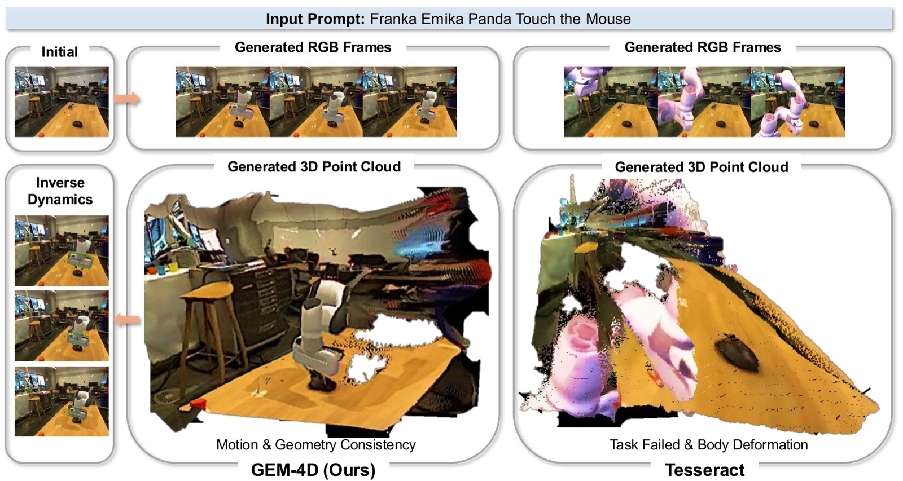

<div align="center">

  <h1>GEM-4D: Geometry-Enhanced Video World Models<br/>for Robot Manipulation</h1>

  <p>
    <b>Kaichen Zhou</b><sup>1,2,*</sup> &nbsp;
    <b>Yuzhen Chen</b><sup>1,*</sup> &nbsp;
    <b>Fangneng Zhan</b><sup>2</sup> &nbsp;
    <b>Hang Hua</b><sup>4</sup> &nbsp;
    <b>Grace Chen</b><sup>1</sup> &nbsp;
    <b>Xinhai Chang</b><sup>2</sup><br/>
    <b>Ao Qu</b><sup>2</sup> &nbsp;
    <b>Yilun Du</b><sup>1</sup> &nbsp;
    <b>Zhuang Liu</b><sup>3</sup> &nbsp;
    <b>Paul Pu Liang</b><sup>2,†</sup> &nbsp;
    <b>Mengyu Wang</b><sup>1,†</sup>
  </p>

  <p>
    <sup>1</sup>Harvard University &nbsp;&nbsp;
    <sup>2</sup>MIT &nbsp;&nbsp;
    <sup>3</sup>Princeton University &nbsp;&nbsp;
    <sup>4</sup>MIT-IBM Watson AI Lab
  </p>

  <p><sup>*</sup>Equal contribution &nbsp;&nbsp; <sup>†</sup>Joint supervision</p>

  <p>
    <a href="https://arxiv.org/abs/2605.22882"></a>
    &nbsp;
    <a href="https://gem-4d.github.io/"></a>
    &nbsp;
    <a href="https://huggingface.co/datasets/zhouk777/gem4d-weight"></a>
  </p>

</div>



GEM-4D is an image + text → video world model for robot manipulation. During training, a
**Geometry DiT** reads the intermediate features of the video DiT and predicts the flow of a
**masked geometry latent** derived from a frozen geometry foundation model (DepthAnything-3).
Because most geometry tokens are masked and the Geometry DiT sees the scene only through the
video features, minimising its loss pushes 3D correspondence structure into the video backbone.
The branch is **dropped at inference**: the deployed model is an ordinary image-to-video generator
with zero extra cost.

```
first frame + instruction ──► video DiT ──────────────────────────► video velocity ──► L_vid
                                │ m_t  (block `hook_layer`, not detached)
                                ▼
 masked, noised geometry latent ──► Geometry DiT ──► geometry velocity ──► L_geo
 g0 = projector(DA3 features)   (same noise as the video latent)

                        L = L_vid + alpha · L_geo
```

The same implementation runs on two backbones:

| Backbone | Config | Latent | Status |
|---|---|---|---|
| CogVideoX-5b-I2V (42 blocks, ~5 B) | `training/config/cogvideox_*.yaml` | 16 × F/4 × H/8 × W/8 | paper model, released checkpoints |
| Wan2.2-TI2V-5B (30 blocks, 5 B) | `training/config/wan22_ti2v_*.yaml` | 48 × F/4 × H/16 × W/16 | new backbone, no released checkpoints yet |

## Code layout

```
model/gem4d/
  models/backbone.py        backbone interface (encode, noise, loss, forward)
  models/cogvideox.py       CogVideoX-5b-I2V (DDPM v-prediction)
  models/wan.py             Wan2.2-TI2V-5B   (rectified flow, first-frame conditioning)
  models/gem4d.py           GEM-4D module: video DiT + Geometry DiT + frozen projector
  heads/geo_dit.py          Geometry DiT (masked geometry flow)
  geometry/teacher.py       frozen DepthAnything-3 teacher + geometry projector
  utils/video_io.py
model/dependency/depth_anything_3/   vendored DepthAnything-3
training/
  config/                   default.yaml + one file per backbone x {gem4d, rgb}; accelerate_zero2.yaml
  data/manifest.py          manifest format (shared by training, validation, inference)
  data/video_dataset.py     generic dataset — the place to customise data loading
  train_utils/              config loader, checkpointing
  trainer.py                single training loop for every backbone
  launch.py                 entry point
training_bash/train.sh      multi-GPU launcher (accelerate + DeepSpeed ZeRO-2)
training_bash/infer.sh      inference launcher
inference/infer.py          checkpoint -> videos
tools/download_weights.py
examples/                   example manifests
tests/test_smoke.py         CPU tests with tiny random models (`PYTHONPATH=model:. python tests/test_smoke.py`)
```

## Environment

```bash
conda create -n gem4d python=3.10 -y && conda activate gem4d
pip install -r requirements.txt          # diffusers>=0.35 (Wan2.2 TI2V support)
```

## Weights

```bash
python tools/download_weights.py cogvideox da3            # CogVideoX GEM-4D training from the base model
python tools/download_weights.py cogvideox checkpoint-2   # CogVideoX inference
python tools/download_weights.py wan2.2 da3               # Wan2.2-TI2V-5B GEM-4D training
```

| Name | Source | Use as |
|---|---|---|
| `cogvideox/` | [`zhouk777/gem4d-weight`](https://huggingface.co/datasets/zhouk777/gem4d-weight) (= CogVideoX-5b-I2V) | `backbone.base_model` |
| `da3/` | same repo (= [DA3-LARGE-1.1](https://huggingface.co/depth-anything/DA3-LARGE-1.1)) | `geometry.teacher` |
| `checkpoint-1/` | same repo — GEM-4D CogVideoX, step 21000 | `backbone.init_weights` (fine-tuning) |
| `checkpoint-2/` | same repo — GEM-4D CogVideoX, step 42000 | `inference --weights` |
| `Wan2.2-TI2V-5B-Diffusers/` | [`Wan-AI/Wan2.2-TI2V-5B-Diffusers`](https://huggingface.co/Wan-AI/Wan2.2-TI2V-5B-Diffusers) | `backbone.base_model` |

## Data

There are **no predefined datasets**. List your clips in a manifest (JSON or JSONL):

```json
[
  {"video": "rlbench/close_drawer/ep_0001/front.mp4", "prompt": "close the middle drawer", "robot": "Franka robot arm"},
  {"video": "my_lab/frames_0042", "prompt": "push the red block to the left"},
  ["pick orange from white bowl", "rt1/record_00162/49/rgb.mp4", "google robot"]
]
```

| Field | Meaning |
|---|---|
| `video` | `.mp4` / `.webm`, or a folder of frames `0.png, 1.png, …` (an image is also accepted for validation / inference). Relative paths resolve against `data.data_root`, else the manifest's folder. |
| `prompt` | the instruction |
| `robot` | optional embodiment text appended to the prompt; keep it identical at train and test time |

`[prompt, video]` and `[prompt, video, robot]` lists are accepted too; a directory of manifests is
concatenated. Each clip is center-cropped and resized to `data.height × data.width` (480 × 640) and
brought to `data.num_frames` (49) frames: long clips are subsampled uniformly, short clips are padded
with their last frame (prefer ≥ 49-frame clips; `data.min_frames` drops short ones). Frame 0 is the
condition. No depth files are needed: geometry comes from DA3 on the fly.

To customise loading, subclass `training.data.video_dataset.ManifestVideoDataset` and override
`read_frames(entry)`, `resize(frames, entry)` or `get_prompt(entry)`.

## Training

```bash
# GEM-4D on CogVideoX, from the base model, 8 GPUs
bash training_bash/train.sh training/config/cogvideox_gem4d.yaml \
    data.train_manifest=/data/train.json data.val_manifest=/data/val.json

# GEM-4D on Wan2.2-TI2V-5B
bash training_bash/train.sh training/config/wan22_ti2v_gem4d.yaml \
    data.train_manifest=/data/train.json data.val_manifest=/data/val.json

# continue from a saved checkpoint (released or your own export)
bash training_bash/train.sh training/config/cogvideox_gem4d.yaml \
    data.train_manifest=/data/train.json backbone.init_weights=weights/checkpoint-1

# RGB-only fine-tuning baseline (no geometry branch)
bash training_bash/train.sh training/config/cogvideox_rgb.yaml data.train_manifest=/data/train.json
```

Any key in `training/config/default.yaml` can be overridden as `key.sub=value`. Main settings:

| Key | Default | Meaning (paper) |
|---|---|---|
| `geometry.alpha` | 0.03 | weight α of L_geo |
| `geometry.mask_ratio` | 0.5 | fraction of geometry tokens masked (mask mechanism M) |
| `geometry.hook_layer` | 21 (CogVideoX) / 15 (Wan) | block whose output is m_t |
| `geometry.feat_layer` | 12 | DA3 layer used as the geometry representation g0 |
| `geometry.depth` | 4 | Geometry DiT blocks |
| `geometry.warmup` | 100 | linear ramp of α |
| `optim.lr` | 1e-5 | constant with 100 warm-up steps, AdamW (0.9, 0.95), wd 1e-3 |
| `train.max_steps` | 10000 | batch 1 per GPU, 49 × 480 × 640, bf16, gradient checkpointing |

**Starting point.** `backbone.init_weights` accepts a released checkpoint or any exported
`checkpoints/step_N` (its `transformer/` is used). The Geometry DiT starts fresh unless
`geometry.init_geometry=<step_N>/geometry.safetensors` is given; a released CogVideoX checkpoint's
geometry projector is reused automatically so the geometry space stays the same.

**Outputs** (`experiment.output_dir`):
`checkpoints/step_N/transformer/` (diffusers format, for inference / fine-tuning),
`checkpoints/step_N/geometry.safetensors` (Geometry DiT + projector), `checkpoints/state/`
(full resumable state of the newest save), `vis/step_N/*.mp4` (validation, left GT / right
prediction), `logs/` (TensorBoard: `video_loss`, `geo_loss`, `val/*`), `config.yaml`.
Exports keep the newest `checkpoint.keep_last` plus every multiple of `checkpoint.keep_every`.

**Resume.** Re-run the same command with the same `experiment.output_dir`.

## Inference

```bash
bash training_bash/infer.sh --backbone cogvideox --base_model weights/cogvideox \
    --weights weights/checkpoint-2 --manifest examples/val_manifest.json \
    --output_dir outputs/cogvideox --side_by_side

bash training_bash/infer.sh --backbone wan2.2-ti2v-5b --base_model weights/Wan2.2-TI2V-5B-Diffusers \
    --weights runs/wan22_ti2v_gem4d/checkpoints/step_010000 --manifest examples/val_manifest.json \
    --output_dir outputs/wan
```

The first frame of each manifest `video` (or the image) conditions the rollout; the prompt is
`prompt + robot`. Output: `<idx>_<clip>.mp4` (49 frames, 480 × 640) and with `--side_by_side`
`<idx>_<clip>_gt_pred.mp4`. Options: `--steps 50`, `--guidance_scale` (6.0 CogVideoX / 5.0 Wan),
`--num_samples N`, `--cpu_offload`. Exported transformers are plain diffusers models, so they also
work directly with `CogVideoXImageToVideoPipeline` / `WanImageToVideoPipeline(expand_timesteps=True)`.

## Implementation notes

- **Video objective.** CogVideoX keeps its DDPM v-prediction loss (SNR-weighted x0 error); Wan uses
  rectified flow with shifted timesteps (shift 5) and TI2V first-frame conditioning (clean image
  latent at frame 0 with timestep 0, excluded from the loss).
- **Geometry latent.** DA3 ViT-L layer-12 features `[F, 24, 24, 1024]` → frozen 1×1 conv to 256 →
  frozen temporal average (stride 4) → resize to the latent grid → frozen 1×1 conv to the latent
  channels (16 / 48). Geometry and video share one noise sample; the geometry target is the
  backbone's own velocity parametrisation.
- **Reproducing the released CogVideoX checkpoints.** They were trained with an extra Geometry DiT
  input, a stop-grad RGB noise estimate (`geometry.use_eps_hat=true`). It is off by default, as in
  the paper; inference is unaffected.

## Citation

```bibtex
@inproceedings{zhou2026gem,
  title={Gem-4d: Geometry-enhanced video world models for robot manipulation},
  author={Zhou, Kaichen and Chen, Yuzhen and Zhan, Fangneng and Hua, Hang and Chen, Grace and Chang, Xinhai and Qu, Ao and Du, Yilun and Liu, Zhuang and Liang, Paul Pu and others},
  booktitle={European Conference on Computer Vision},
  pages={130--147},
  year={2026},
  organization={Springer}
}
```

## Acknowledgements

Built on [diffusers](https://github.com/huggingface/diffusers), [CogVideoX](https://github.com/THUDM/CogVideo),
[Wan2.2](https://github.com/Wan-Video/Wan2.2), [Depth Anything 3](https://github.com/ByteDance-Seed/Depth-Anything-3)
and [TesserAct](https://github.com/UMass-Embodied-AGI/TesserAct).
